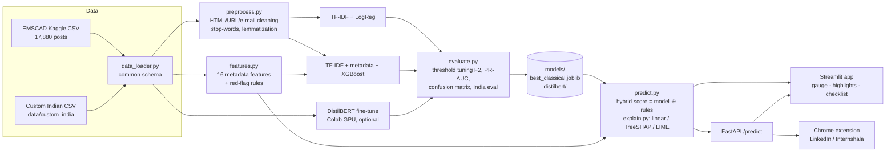

# 🛡️ Fake Job & Internship Scam Detector

An end-to-end NLP project that reads a job/internship post and predicts whether it is **Real or Fake**, gives a **scam-risk score (0–100)**, and **explains why** by highlighting suspicious phrases and listing the red flags it found.

**Stack:** Python · scikit-learn · XGBoost · Hugging Face Transformers (DistilBERT) · LIME / TreeSHAP · FastAPI · Streamlit · Docker · Chrome Extension (Manifest V3)

---

## 1. Problem statement

Students in India look for internships and first jobs on LinkedIn, Internshala, Telegram channels and college WhatsApp groups, and scammers follow them there. The usual pattern is the same every time:

* a **registration / training / "refundable security" fee** before joining,
* pay that is too good to be true (*"earn ₹50,000 per week from home"*),
* contact **only via WhatsApp or Telegram**, recruiters with **Gmail/Yahoo** addresses,
* **no interview**, *"direct joining"*, *"limited seats — hurry!"*,
* requests for **Aadhaar, PAN, bank details or OTPs**.

Students lose money and personal data, and job boards can't review every post by hand. This project builds an assistant that flags risky posts **before** a student pays or shares anything, and explains its reasons so the student can learn to spot the patterns too.

> 💡 Add one or two recent, cited statistics on job/internship fraud in India here (e.g. from news reports or government advisories) to make this section stronger for your portfolio.

---

## 2. Architecture



**Hybrid decision:** `p_final = 1 − (1 − p_model) × (1 − 0.7 × rule_score)`.
Rules can only *raise* the risk, so Indian scam signals the Kaggle-trained model has never seen still count. If the rule score alone is ≥ 0.70 (for example *fee* + *Gmail*), the post is labelled Fake whatever the model says. The risk score is rescaled so that **50 = the tuned decision threshold**.

---

## 3. Data

### 3.1 EMSCAD — "Real or Fake Job Posting Prediction" (Kaggle)
* 17,880 posts (2012–2014, mostly US/UK), **~4.8 % fraudulent**.
* Download: <https://www.kaggle.com/datasets/shivamb/real-or-fake-fake-jobposting-prediction>
* Save as **`data/raw/fake_job_postings.csv`**, or run `python -m src.data_loader --download` (needs `pip install kaggle` and `~/.kaggle/kaggle.json`).
* Mapping to the app's inputs: `text` = title + company profile + description + requirements + benefits; `company` = company profile; `salary` = salary_range.
* `has_company_logo` is very predictive but is **not used**, because a user pasting text can't supply it (avoids train/serve skew).

### 3.2 Custom Indian dataset — `data/custom_india/`
* `custom_india.csv` with columns `text, company, email, salary, source, label` (1 = fake).
* Ships with **40 synthetic examples** (20 scam, 20 legitimate), marked `source = synthetic_example`. **Replace them with real, collected posts** (see `data/custom_india/README.md`).
* Add samples with `python data/custom_india/add_sample.py` (interactive, `--text …`, or `--from-csv`).
* Used **only for evaluation**, to measure how well the model generalises from US data to Indian scams.

---

## 4. ML pipeline

| Step | What | Where |
|---|---|---|
| EDA | class imbalance, text length, word clouds, distinctive bigrams, missing-field patterns | `notebooks/01_eda.ipynb` |
| Preprocessing | HTML unescape/strip, URLs/e-mails/phones → tokens (incl. EMSCAD `#URL_…#`), lowercase, letters only, stop-words (keeps *no/not/without*), WordNet lemmatization | `src/preprocess.py` |
| Metadata features | free e-mail domain, salary missing / too high (parses ₹, k, lakh, LPA, per week/day…), company missing, asks for payment (negation-aware), WhatsApp/Telegram, no interview, easy money, personal-info request, urgency count, caps ratio, `!` count, emoji count, length | `src/features.py` |
| Models | ① TF-IDF + LogReg (baseline) ② TF-IDF + metadata + XGBoost ③ DistilBERT (HF Trainer, weighted loss) | `src/train_classical.py`, `src/train_bert.py` |
| Imbalance | class weights (`balanced`, `scale_pos_weight`, weighted CE loss) **vs** SMOTE for classical models | same |
| Split | stratified 70/15/15, `SEED = 42` everywhere | `src/data_loader.py`, `src/config.py` |
| Threshold | tuned on **validation** to maximise **F2** (recall weighted 2×) | `src/evaluate.py` |
| Metrics | precision, recall, F1, F2, PR-AUC, ROC-AUC, confusion matrix, plus an *always-real* dummy baseline | `src/evaluate.py` |
| Explainability | exact linear contributions (LogReg), native **TreeSHAP** (XGBoost), **LIME** (any model incl. DistilBERT), rule checklist with evidence | `src/explain.py` |

### Why accuracy is misleading here
With ~95 % real posts, a model that **always says "real"** gets ~95 % accuracy and catches **zero** scams. The comparison table includes that dummy model on purpose. We optimise **recall on the fake class**, because a missed scam can cost a student money and identity documents, while a false alarm only costs a second look. We also report **precision** so the tool doesn't flag everything, and **PR-AUC** to compare models without picking a threshold.

---

## 5. Results

Run `python -m src.train_classical --update-readme` (and optionally DistilBERT on Colab, then `python -m src.evaluate --update-readme`) to fill this section automatically with your numbers.

<!-- RESULTS_START -->
_Auto-generated by `python -m src.evaluate --update-readme`._

**Kaggle EMSCAD test set** (fake = positive class)

| Model | Mode | Precision | Recall | F1 | PR-AUC | Accuracy | TP / FN / FP |
|---|---|---|---|---|---|---|---|
| tfidf_logreg | hybrid | 0.702 | 0.806 | 0.750 | 0.849 | 0.976 | 87 / 21 / 37 |
| tfidf_logreg_smote | hybrid | 0.705 | 0.796 | 0.748 | 0.850 | 0.976 | 86 / 22 / 36 |
| tfidf_meta_xgb | hybrid | 0.816 | 0.741 | 0.777 | 0.817 | 0.981 | 80 / 28 / 18 |
| tfidf_meta_xgb_smote | hybrid | 0.792 | 0.778 | 0.785 | 0.837 | 0.981 | 84 / 24 / 22 |
| always_real_baseline | model_only | 0.000 | 0.000 | 0.000 | 0.045 | 0.955 | 0 / 108 / 0 |
| tfidf_logreg | model_only | 0.688 | 0.796 | 0.738 | 0.841 | 0.975 | 86 / 22 / 39 |
| tfidf_logreg_smote | model_only | 0.741 | 0.796 | 0.768 | 0.843 | 0.978 | 86 / 22 / 30 |
| tfidf_meta_xgb | model_only | 0.582 | 0.824 | 0.682 | 0.826 | 0.966 | 89 / 19 / 64 |
| tfidf_meta_xgb_smote | model_only | 0.688 | 0.815 | 0.746 | 0.851 | 0.975 | 88 / 20 / 40 |

**Custom Indian dataset** (fake = positive class)

| Model | Mode | Precision | Recall | F1 | PR-AUC | Accuracy | TP / FN / FP |
|---|---|---|---|---|---|---|---|
| tfidf_logreg | hybrid | 1.000 | 1.000 | 1.000 | 1.000 | 1.000 | 20 / 0 / 0 |
| tfidf_logreg_smote | hybrid | 1.000 | 1.000 | 1.000 | 1.000 | 1.000 | 20 / 0 / 0 |
| tfidf_meta_xgb | hybrid | 1.000 | 1.000 | 1.000 | 1.000 | 1.000 | 20 / 0 / 0 |
| tfidf_meta_xgb_smote | hybrid | 1.000 | 1.000 | 1.000 | 1.000 | 1.000 | 20 / 0 / 0 |
| always_real_baseline | model_only | 0.000 | 0.000 | 0.000 | 0.500 | 0.500 | 0 / 20 / 0 |
| tfidf_logreg | model_only | 0.909 | 0.500 | 0.645 | 0.869 | 0.725 | 10 / 10 / 1 |
| tfidf_logreg_smote | model_only | 1.000 | 0.500 | 0.667 | 0.878 | 0.750 | 10 / 10 / 0 |
| tfidf_meta_xgb | model_only | 1.000 | 0.600 | 0.750 | 0.968 | 0.800 | 12 / 8 / 0 |
| tfidf_meta_xgb_smote | model_only | 1.000 | 0.450 | 0.621 | 0.974 | 0.725 | 9 / 11 / 0 |

<!-- RESULTS_END -->

Plots are saved to `results/`: `pr_curve_emscad_test.png`, `pr_curve_custom_india.png`, `cm_<model>_<dataset>.png`. The full table is in `results/model_comparison.csv`.

**How to read it:** compare `model_only` vs `hybrid` on the **custom Indian** rows. The gap shows how much the rule layer makes up for the domain shift from US to Indian posts. Note that the rules were written alongside the synthetic examples, so Indian-set scores are optimistic until you replace them with real data.

---

## 6. App

### Screenshots
| Check a post | Model comparison | Chrome extension |
|---|---|---|
|  |  |  |

*(Placeholders: take screenshots after running the app and save them under `docs/screenshots/`.)*

### FastAPI — `POST /predict`
```json
// request
{"text": "Earn ₹50,000/week from home. Pay registration fee ₹999. WhatsApp 9000000001",
 "company": "", "email": "hr.jobs@gmail.com", "salary": "", "explain": "auto"}
// response (abridged, illustrative values)
{"label": "Fake", "risk_score": 91.4, "risk_level": "high", "model_probability": 0.83,
 "rule_score": 0.93, "highlighted_words": [{"term": "registration fee", "weight": 0.71}],
 "red_flags": [{"name": "Asks for money / registration fee", "triggered": true,
                "evidence": ["registration fee"]}], "warnings": []}
```
Other endpoints: `GET /health`, `GET /model-info`. Interactive docs at `/docs`.

### Edge cases handled
* **Empty input** → HTTP 422 / UI error. **Over 20,000 chars** → 422.
* **Very short text** (< 15 words) → prediction plus a *low-confidence* warning.
* **Hindi/Marathi (Devanagari)** → the model is skipped and only the rules run, with a warning. **Other non-English** text → warning.
* **No trained model** → the app still works in *rules-only* mode.
* **No GPU / no transformers** → DistilBERT is skipped automatically and the classical model is used.
* XAI failure never breaks a prediction; it falls back and adds a warning.

---

## 7. Setup & run

Requires **Python 3.10–3.12**.

### Linux / macOS
```bash
git clone <your-repo-url> fake-job-detector && cd fake-job-detector
python3 -m venv .venv && source .venv/bin/activate
pip install -r requirements.txt
python -c "import nltk; nltk.download('wordnet'); nltk.download('omw-1.4')"

# data: put fake_job_postings.csv in data/raw/ (or: python -m src.data_loader --download)
python -m src.data_loader                      # sanity check
python -m src.train_classical --update-readme  # ~3-10 min on a laptop (--quick for 30 % sample)
pytest                                         # run tests

uvicorn api.main:app --reload --port 8000      # terminal 1 - API  → http://localhost:8000/docs
streamlit run ui/streamlit_app.py              # terminal 2 - UI   → http://localhost:8501
```

### Windows (PowerShell)
```powershell
git clone <your-repo-url> fake-job-detector; cd fake-job-detector
py -3.11 -m venv .venv
.\.venv\Scripts\Activate.ps1        # if blocked: Set-ExecutionPolicy -Scope CurrentUser RemoteSigned
pip install -r requirements.txt
python -c "import nltk; nltk.download('wordnet'); nltk.download('omw-1.4')"

python -m src.data_loader
python -m src.train_classical --update-readme
pytest

uvicorn api.main:app --reload --port 8000
streamlit run ui/streamlit_app.py
```
To make Streamlit call the API instead of loading the model itself: `export API_URL=http://localhost:8000` (Linux) / `$env:API_URL="http://localhost:8000"` (PowerShell).

### Quick CLI test
```bash
python -m src.predict "Earn 5000 daily from home! Registration fee Rs 499. WhatsApp now" --email abc@gmail.com
```

### DistilBERT (optional)
1. Open `notebooks/03_distilbert_colab.ipynb` in Google Colab → *Runtime → T4 GPU* → run all (~15–25 min).
2. Download `distilbert_model.zip`, unzip into the project so you get `models/distilbert/`.
3. `pip install -r requirements-bert.txt`, then run with `USE_BERT=1` (`$env:USE_BERT="1"` on Windows).
Without these steps the app runs on the classical model, so a laptop without a GPU is fine.

### Chrome extension
1. Start the API (`uvicorn api.main:app --port 8000`).
2. Open `chrome://extensions` → enable **Developer mode** → **Load unpacked** → select `extension/`.
3. On LinkedIn/Internshala, **select** the post text → click the extension icon (or right-click → *Check selected text for job scam*).
4. In the popup's *Settings*, set the API URL to your deployed API Space if you use one.

### Docker
```bash
docker build -t fake-job-detector .
docker run -p 7860:7860 fake-job-detector                      # Streamlit UI
docker run -p 8000:8000 -e APP_MODE=api -e PORT=8000 fake-job-detector   # API only
docker run -p 7860:7860 -e APP_MODE=both fake-job-detector     # API + UI in one container
```
Train first so `models/` contains `best_classical.joblib` and `model_meta.json`, because they are copied into the image.

---

## 8. Deploy on Hugging Face Spaces

**UI Space (Streamlit, runs the model in-process):**
1. Create a Space → SDK **Docker** → blank template.
2. Add this front-matter at the top of the Space's `README.md`:
   ```yaml
   ---
   title: Job Scam Detector
   emoji: 🛡️
   colorFrom: blue
   colorTo: red
   sdk: docker
   app_port: 7860
   ---
   ```
3. Push the project **including** `models/best_classical.joblib`, `models/model_meta.json`, `results/` and `data/custom_india/`:
   ```bash
   git lfs install && git lfs track "*.joblib" "*.safetensors"
   git remote add space https://huggingface.co/spaces/<user>/<space-name>
   git add . && git commit -m "deploy" && git push space main
   ```
4. The Space builds the Dockerfile and serves Streamlit on port 7860 (`APP_MODE=ui` by default).

**API Space (for the Chrome extension):** create a second Docker Space from the same repo and set a Space **variable** `APP_MODE=api`. Your API is then at `https://<user>-<space-name>.hf.space/predict`. Put that base URL in the extension settings.

DistilBERT on the free CPU tier works but is slow (~1 s per post). Set the variable `USE_BERT=1` and add `requirements-bert.txt` to the Dockerfile only if you need it.

---

## 9. Project structure
```
fake-job-detector/
├── notebooks/            01_eda · 02_classical_models · 03_distilbert_colab
├── data/
│   ├── raw/              fake_job_postings.csv (download)
│   ├── processed/        cached preprocessed frames
│   └── custom_india/     custom_india.csv · template.csv · add_sample.py · README.md
├── src/
│   ├── config.py         paths, seeds, constants
│   ├── data_loader.py    EMSCAD + custom loaders, stratified split, Kaggle download
│   ├── preprocess.py     cleaning, lemmatization, language detection, input validation
│   ├── features.py       metadata features, salary parser, red-flag rules
│   ├── train_classical.py LogReg / XGBoost × class-weights / SMOTE
│   ├── train_bert.py     DistilBERT fine-tuning + BertScorer
│   ├── evaluate.py       metrics, thresholds, plots, results table, README update
│   ├── explain.py        linear contributions, TreeSHAP, LIME, highlighting
│   └── predict.py        Predictor (hybrid scoring, fallbacks)
├── api/main.py           FastAPI
├── ui/streamlit_app.py   Streamlit (check post · model comparison · about)
├── extension/            Manifest V3 Chrome extension
├── models/  results/     artefacts (generated)
├── tests/                pytest: preprocessing, features, predictor, API
├── Dockerfile  start.sh  requirements*.txt
└── README.md
```

---

## 10. Limitations & future work

**Limitations**
* EMSCAD is old (2012–14) and US/UK-centric, so scam language has changed (crypto, task-based "like & earn" scams, Telegram).
* The Indian evaluation set starts as **synthetic** examples. Real collected data is needed before claiming generalisation.
* English only. Romanised Hindi ("Hinglish") is treated as English, and Devanagari text gets rule checks only.
* Rules are hand-written, so scammers can reword around them (e.g. "regn. amt").
* Class-weighted probabilities are not calibrated, so the risk score is a ranking signal, not a true probability.

**Future work**
* **Multilingual:** fine-tune `xlm-roberta-base` / `muril-base-cased` (Google's model for Indian languages) on Hindi/Marathi/Hinglish posts.
* **Image-based scam posters:** OCR (Tesseract / EasyOCR / PaddleOCR) on WhatsApp poster images, then the same pipeline.
* **Real Indian dataset:** collect and label posts with classmates and report results with confidence intervals.
* **Entity verification:** check the company on the MCA21 register, look up domain age (WHOIS), compare e-mail domain with company website.
* **Calibration** (Platt / isotonic) and **active learning** from user feedback ("was this correct?").
* **Drift monitoring** and periodic retraining. Adversarial tests with paraphrased scams.

---

## 11. Disclaimer
This tool estimates risk and is not proof that a post is fraudulent or genuine. Always verify the employer independently, and **never pay to get a job**. In India you can report cyber fraud at **cybercrime.gov.in** or the helpline **1930**.
